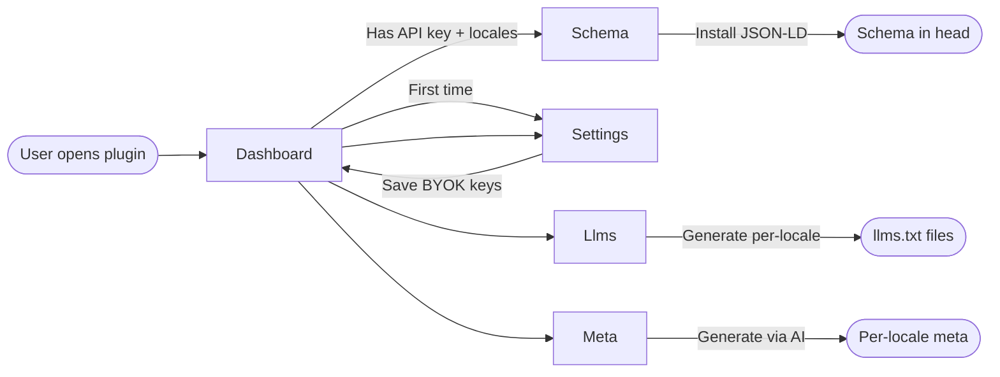
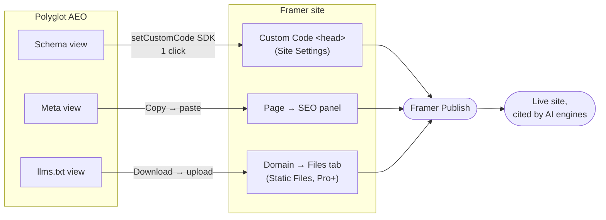
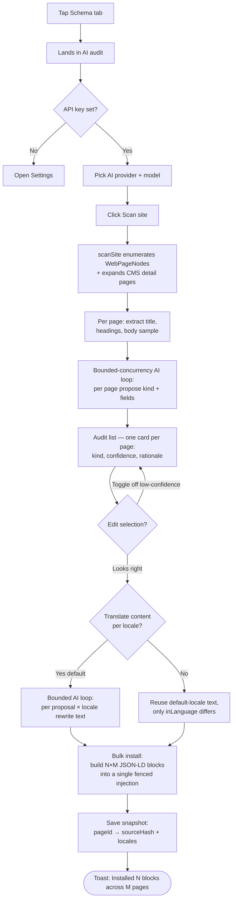
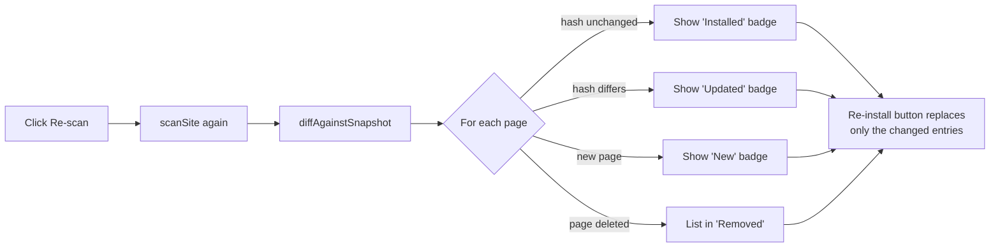
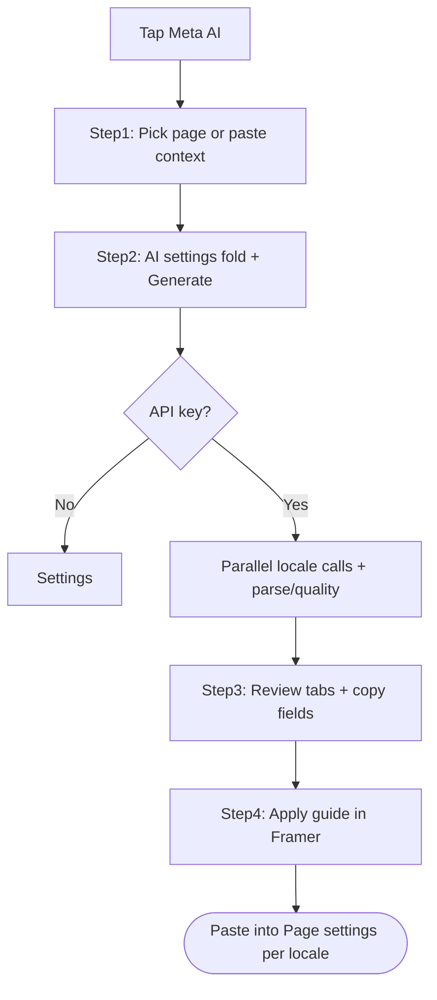
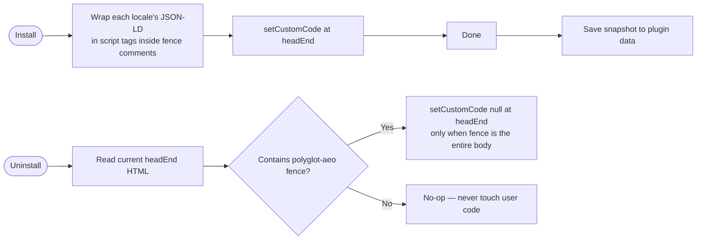

# UI flow

Visual map of how a user moves through Polyglot AEO. Renders in any Markdown
viewer that supports Mermaid (GitHub, VS Code with the Mermaid extension,
etc.).

## High-level navigation



## Framer-native deployment paths (where each output ends up)

Polyglot AEO is designed so every artifact lands directly in Framer's own
publishing surfaces — users never export code or move to another tool.



**Plan gate**: the `Domain → Files tab` (Framer Static Files) requires
Framer Pro plan or higher. The plugin surfaces this as a "Framer Pro+" pill
on the deploy guide so users aren't surprised. Schema and Meta paths work on
every Framer plan.

## Schema generation flow — AI audit (default path)

The audit flow turns Schema from a per-page form into a site-wide AI agent.
Click **Scan site** once and Polyglot AEO enumerates every page in the
project, picks the right schema kind for each, fills the fields from the
on-canvas content, and (if enabled) translates everything into every
non-default locale before bulk-installing the result.



### Re-scan + diff loop

After install, the snapshot lives in plugin data. Re-opening the plugin
later shows a **Last installed** card. Clicking **Re-scan** runs the full
flow again and surfaces changes:



### Manual mode (legacy / surgical control)

A small **Switch to manual mode** link at the bottom of the audit view
falls back to the original kind-picker form. This stays for power users
who want to add a schema kind the auditor doesn't propose, or to edit a
single page's JSON-LD by hand.

## AI Meta flow

Four-step wizard (see `docs/META-AI.md`):



## llms.txt generation + deployment flow

```mermaid
flowchart TD
    A[Tap llms.txt tab] --> B[Fill site name + base URL + summary]
    B --> C{CMS Collection<br/>available?}
    C -->|Yes| D[Pick Collection<br/>+ map title/summary fields]
    C -->|No| E[Site summary only<br/>show Collection-empty hint]
    D --> F[Click Generate N files]
    E --> F
    F --> G[Render llms.txt + llms-{locale}.txt<br/>per locale to React state]
    G --> H[Show generated files<br/>with Copy / Download buttons]
    H --> I[Show 'How to deploy on Framer'<br/>guide with Pro+ badge]
    I --> J[User downloads each file]
    J --> K[Open Framer Dashboard<br/>→ Domains → your domain → Files]
    K --> L[Upload each file at root path]
    L --> M[Publish site]
    M --> N([Files served at /llms.txt,<br/>/llms-zh-cn.txt, ...])
```

The deploy guide is rendered **inline below the generated files**, with a
direct link to Framer's official static-files article. We chose this over
external documentation because the average user who just clicked "Generate"
is mid-task and shouldn't have to leave the plugin to find next steps.

## Install / uninstall safety



The fence guarantees we never delete custom code we didn't author. If a
user mixes Polyglot AEO output with hand-written JSON-LD in the same
location, we surface a notice and require manual cleanup rather than risk
data loss.
