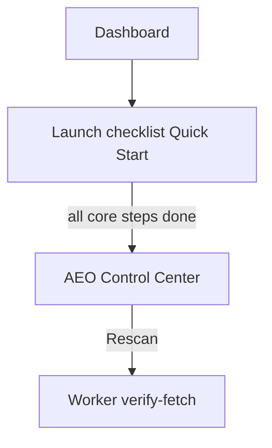

# UX & Onboarding Implementation Plan

**Source:** Dashboard / plugin UX review (2026-06).
**Scope:** Trust (dual scores), unified launch checklist, Onboarding v2, Dashboard simplification, light polish.
**Out of scope (do not drift):** citation monitoring, new pricing tier, Marketplace rewrite, case-study page, Weglot mentions, Schema/Meta feature work unrelated to copy/navigation.

---

## Goal

One clear **launch path** for users: diagnose (optional) → produce assets → publish → verify → **AEO control center** as the authoritative readiness score. Dashboard stops showing two competing “health %” checklists.

---

## Architecture (target state)

| Surface | Role after plan |
|---------|-----------------|
| **Quick Start** | Only onboarding checklist on Dashboard; 6–7 signal-driven steps |
| **Dashboard “AEO 就绪度” card** | **Removed** (merged into Quick Start) |
| **Control center %** | **Authoritative** launch readiness (issues + CMS + live verify) |
| **Google Rich Results** | Optional external link in Schema help only — not a Quick Start step |

---

## Phase 0 — Trust & correctness (P0)

### 0.1 Clarify scores; funnel to control center

**Problem:** Dashboard checklist % ≠ control center weighted score → feels inconsistent.

**Changes:**

- Remove standalone `dashboard.healthTitle` / health card from `Dashboard.tsx`.
- Quick Start title/copy: position as **「上线清单」** / “Launch checklist” (i18n keys: repurpose `dashboard.quickStartTitle` or add `dashboard.launchChecklistTitle`).
- After Quick Start header (or when collapsed), one line helper: **「完整评估请打开 AEO 控制台」** with button → `onOpen("control")`.
- Control center: keep existing score; optional subtitle under readiness %: **「含 CMS 缺口与发布后 live 检查」** (`control.readinessHint`).

**Files:** `src/views/Dashboard.tsx`, `src/views/AeoControlCenterView.tsx`, `src/i18n/locales/{en,zh-CN,ja}.ts`

**Acceptance:** Dashboard shows exactly one progress bar (Quick Start). Control center is linked as the place for “real” launch score.

---

### 0.2 Quick Start: verify step → in-plugin verifier

**Problem:** Step 5 opens Google externally; skips Polyglot verifier.

**Changes:**

- `StepId`: rename `verify` → `verifyPublished` (or keep id, change action only).
- `handleAction` in `QuickStart.tsx`: `onOpen("verify")` instead of `window.open(Rich Results)`.
- i18n `quickStartSteps.verify*`: describe homepage / JSON-LD / llms.txt live checks; mention publish + Static Files if needed.
- Completion signal: `publishedVerifyDone` — true when `StorageKeys.LastPublishedVerify` exists and `failureCount === 0` OR user ran verify once (store `verifiedAt` even with failures — step “done” = **ran check**, “optional” if schema not installed). **Pick one rule and document in `onboarding.ts` comment:**
  - **Recommended:** `done` if `LastPublishedVerify` exists; `pending` if schema installed but never run; `optional` if schema missing.

**Files:** `src/lib/onboarding.ts`, `src/lib/onboarding.test.ts`, `src/components/QuickStart.tsx`, `src/views/Dashboard.tsx` (pass signal), `src/i18n/locales/*`

**Acceptance:** Quick Start verify button opens `PublishedVerifierView`; no required external URL for checklist completion.

---

### 0.3 Single-locale projects: don’t block checklist

**Problem:** `addLocales` pending forever when `localeCount === 1`.

**Changes:**

- `deriveState("addLocales")`: if `localeCount >= 2` → `done`; if `localeCount === 1` → **`optional`** (not pending); if `0` → `pending`.
- Update `onboarding.test.ts` for `localeCount: 1` → `optional`.
- i18n `addLocalesDesc`: “多语言价值最大；单语言可先完成 Schema 与 llms”.

**Files:** `src/lib/onboarding.ts`, `src/lib/onboarding.test.ts`, i18n

**Acceptance:** Single-locale user can reach 100% Quick Start without adding locales.

---

### 0.4 Hero copy: deliverable, not guarantee

**Problem:** “Get cited by ChatGPT…” overpromises vs terms/pricing.

**Changes:** Update `dashboard.subtitle` only (en / zh-CN / ja) to outcome-neutral: e.g. “Prepare multilingual structured data for AI search — Schema, llms.txt, and meta.”

**Files:** `src/i18n/locales/*` — **no** Marketplace/terms edits in this plan unless explicitly added later.

**Acceptance:** Hero does not imply guaranteed AI citations.

---

## Phase 1 — Onboarding v2 steps (P0/P1)

### 1.1 Add steps: deploy llms + control center

**New / updated `StepId` order:**

1. `addLocales` (optional @ 1 locale)
2. `installSchema`
3. `generateLlms`
4. `deployLlms` — **new**; `done` when user downloaded ZIP (`LastLlmsTxt` exists counts as generate done; deploy: set flag `StorageKeys.LlmsDeployAcknowledged` on first ZIP download OR checkbox in llms review “我已上传到 Static Files”)
5. `addApiKey` — optional
6. `generateMeta` — **new** optional; `done` if `LastMetaResults` exists (signal already on Dashboard)
7. `verifyPublished` — in-plugin verify (0.2)
8. `openControlCenter` — **new**; `done` when user opened control once (`StorageKeys.ControlCenterOpened` on first `onOpen("control")`)

**Simplification option (if 8 steps too many):** merge 7+8 into one step “验证并打开控制台”.

**Recommended lean set (7 steps):** locales, schema, llms, deployLlms, apiKey (opt), meta (opt), verifyPublished — control center CTA in Quick Start footer when `isAllDone`, not a separate step.

**Files:** `src/lib/onboarding.ts`, `src/lib/storage.ts`, `src/lib/onboarding.test.ts`, `QuickStart.tsx`, `LlmsTxtView.tsx` (set deploy ack), `AeoControlCenterView.tsx` or `Dashboard` (set opened flag), i18n `dashboard.quickStartSteps.*`

**Acceptance:** Checklist reflects publish path; Meta optional; deploy llms documented in step copy + link to llms tool.

---

### 1.2 Quick Start footer: control center CTA

When `isAllDone` or `progress.ratio >= 0.85`, show secondary button **「打开 AEO 控制台」** → `onOpen("control")` (in addition to Dismiss).

**Files:** `QuickStart.tsx`, i18n

---

## Phase 2 — Dashboard layout (P1)

### 2.1 Section order (reduce scroll)

Target order:

1. Hero (status pill + locale switcher)
2. Workflow stack card (existing)
3. Pro upgrade banner (if applicable)
4. **Launch checklist** (Quick Start only)
5. **Tools** list (primary actions)
6. **Locales** card (collapse to summary row when `locales.length > 0` — show count + “查看” expand, or move locales into hero pill only)

**Files:** `Dashboard.tsx`, `globals.css` (optional `.pa-locales-collapsed`)

**Acceptance:** Tools visible within ~1.5 scrolls on 320×540; no duplicate health card.

---

### 2.2 Tool list icons

| Tool | Icon change |
|------|-------------|
| Control center | New `ControlIcon` or reuse distinct glyph (grid/checklist) |
| CMS gaps | `CmsIcon` or `CollectionIcon` — not `LlmsIcon` |
| Published verify | Keep `VerifyIcon` |
| llms | Keep `LlmsIcon` |

**Files:** `src/components/icons.tsx`, `Dashboard.tsx`

**Acceptance:** Six tools distinguishable by icon at a glance.

---

## Phase 3 — Light polish (P2, after P0–P2 core)

### 3.1 Loka path in checklist intro

One line under Quick Start title when `localeCount >= 2`: **「正文用 Loka？完成翻译后从 Schema 开始」** + link `LOKA_FRAMER_MARKETPLACE` (stack already covers; avoid duplicate — **only** add if stack card dismissed/hidden; else skip).

**Decision:** **Skip separate Loka step** — stack card already covers; **no file change** unless stack removed later.

---

### 3.2 Wizard time hints

Add one helper line on first step of `LlmsTxtView` setup and Schema audit hero: **「约 3–5 分钟」** (i18n).

**Files:** `LlmsTxtView.tsx`, `SchemaAuditView.tsx`, i18n

---

### 3.3 Optional: default plugin height

`App.tsx` `framer.showUI`: `height: 580` (from 540) — only if QA confirms; single numeric tweak.

---

## Testing

| Area | Action |
|------|--------|
| `onboarding.test.ts` | Update for locales@1 optional, new steps, verify signal |
| Manual | Single-locale project, multi-locale Free, Pro, with/without `VITE_LICENSE_API_BASE` |
| Regression | Settings → reset Quick Start still works |

---

## Implementation order (strict)

1. Phase 0.3 single-locale (small, unblocks)
2. Phase 0.2 verify in-plugin
3. Phase 0.1 remove health card + copy funnel to control
4. Phase 1.1 onboarding steps + storage keys
5. Phase 1.2 control CTA footer
6. Phase 0.4 hero i18n
7. Phase 2.1 dashboard order
8. Phase 2.2 icons
9. Phase 3.2 time hints (3.1 skip, 3.3 optional)

**Estimated effort:** 1.5–2.5 days focused; no new backend except optional storage keys.

---

## Todos (tracking)

| ID | Phase | Task |
|----|-------|------|
| `ux-p0-single-locale` | 0.3 | `addLocales` optional at 1 locale + tests + i18n |
| `ux-p0-verify-inapp` | 0.2 | Quick Start verify → `verify` route + signal + i18n |
| `ux-p0-unify-scores` | 0.1 | Remove Dashboard health card; checklist + control funnel copy |
| `ux-p0-hero-copy` | 0.4 | Neutral hero subtitle (3 locales) |
| `ux-p1-onboarding-steps` | 1.1 | deployLlms + meta optional + storage signals + tests |
| `ux-p1-control-footer` | 1.2 | Quick Start footer → control center |
| `ux-p1-dashboard-order` | 2.1 | Reorder sections; compact locales |
| `ux-p1-tool-icons` | 2.2 | Distinct icons for control + CMS |
| `ux-p2-wizard-hints` | 3.2 | Time estimates on llms + schema entry |
| `ux-p2-plugin-height` | 3.3 | Optional `showUI` height bump |

---

## Explicit non-goals

- Full-screen onboarding tour or video
- Persona selection modal (use copy branches only)
- Merging control center logic into Dashboard score
- Auto-upload llms to Framer
- New Creem / pricing flows
